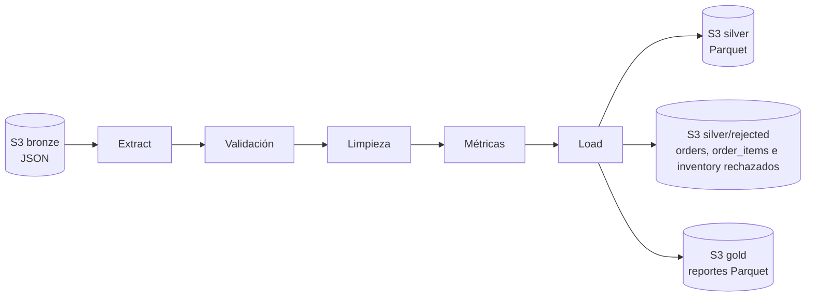

# Pipeline ETL de ecommerce (arquitectura medallion sobre S3)

Pipeline en Python que toma los datos crudos de un e-commerce desde S3, los limpia y calcula cinco reportes de negocio. Todo se guarda en Parquet, separado en tres capas: bronze (crudo), silver (limpio) y gold (reportes). Los reportes de gold también salen en CSV para abrirlos en Excel.

## Resumen

El origen son 11 archivos JSON exportados del sistema transaccional. Traen pedidos repetidos, pedidos sin cliente o sin monto, textos con espacios y saltos de línea, y líneas de pedido que apuntan a pedidos o productos que no existen. Si se calculan las ventas sobre esos datos, los números salen mal.

El pipeline resuelve esos problemas antes de calcular los reportes y deja registro de todo lo que descarta:

- De 5.150 pedidos de origen quedan 4.248 en silver: 150 estaban repetidos y 752 (sin cliente o sin monto) se apartan a una tabla de rechazados con el motivo.
- De 15.582 líneas de pedido, 453 estaban duplicadas. De las 15.129 restantes, 10.993 pasan y 4.136 (27,3%) van a una tabla de rechazados con el motivo de cada una.
- El dato crudo en bronze no se modifica, así que cualquier regla de limpieza se puede corregir y volver a correr.

## Contexto de negocio

Los reportes responden las preguntas que el área comercial y de logística hacen sobre la operación:

| Reporte | Pregunta que responde | Cómo se calcula |
|---|---|---|
| `reporte_clientes` | ¿Quiénes son los 5 clientes que más compran? | Suma del monto y cantidad de sus pedidos, sin canceladas |
| `reporte_producto_mas_vendido` | ¿Qué producto se vende más? | Unidades vendidas por `product_id`, sin canceladas, se queda con el primero |
| `reporte_ventas_mensual` | ¿Cómo evolucionan las ventas mes a mes? | Suma del monto de los pedidos por mes, sin canceladas. Los pedidos sin fecha válida (nula o futura) quedan fuera y se avisa |
| `reporte_logistica_depositos` | ¿Qué tan lleno está cada depósito? | Stock actual sobre capacidad, en porcentaje |
| `reporte_rotacion_inventario` | ¿Qué tan rápido rota el inventario en cada depósito? | Unidades vendidas, sin canceladas, sobre stock actual |

Con los datos tal como llegan, cada una de esas respuestas sale distorsionada. Un pedido repetido infla las ventas, un pedido cancelado suma como ingreso y un cliente con un espacio de más en el email no cruza con sus compras.

## Arquitectura



- **bronze:** los 11 JSON de origen, tal como llegan.
- **silver:** una tabla limpia por cada archivo de origen, con columnas `dq_*` que marcan los registros sospechosos, más tablas aparte con los registros rechazados y el motivo.
- **gold:** los 5 reportes en Parquet y en CSV.

Separar en capas permite reprocesar desde bronze cuando cambia una regla, sin volver a pedir el dato al sistema de origen.

## Decisiones de diseño

### Qué se descarta, qué se conserva y por qué

**Las líneas inválidas de `order_items` se apartan en vez de borrarse.** Van a `silver/rejected/order_items.parquet` con la columna `motivo_rechazo`. Preferí esto a un `dropna` porque cada línea rechazada es una venta que alguien tiene que poder revisar en el sistema de origen. Si la tasa de rechazo supera `REJECT_THRESHOLD` (5% por defecto), el log emite un warning.

| Motivo del rechazo | Registros |
|---|---|
| Pedido descartado en `orders` (sin cliente o sin monto) | 1.968 |
| `order_id` nulo | 1.206 |
| `order_id` que no existe en `orders` | 571 |
| `product_id` que no existe en `products` | 391 |

**Los pedidos sin cliente o sin monto se apartan a rechazados.** Sin cliente no se puede atribuir la venta, y sin monto no se puede sumar a ningún reporte. Imputarlos sería inventar una venta, así que no entran a silver, pero tampoco se borran: van a `silver/rejected/orders.parquet` con el motivo (`total_amount nulo`: 389, `customer_id nulo`: 336, ambos: 27). Si un `order_id` llega repetido y una de las versiones es válida, queda esa y el pedido no se rechaza. Entre las repetidas me quedo con la de fecha más reciente, para que un mismo pedido no cuente dos veces. La cuenta cierra: 5.150 filas de origen son 150 repetidas, 752 pedidos rechazados y 4.248 en silver.

**Las líneas con `product_id` nulo y pedido válido se conservan.** La venta existió y solo se desconoce el producto. Borrarla subestimaría las ventas; lo único que pierde es la posibilidad de entrar en los rankings por producto.

**Los pedidos cancelados siguen en silver pero no suman en ningún reporte.** Ni como ingreso en clientes y ventas mensuales, ni como unidades vendidas en el producto más vendido y la rotación. Quedan en silver porque el dato de cuántos se cancelan también es información de negocio. La regla se aplica igual a los cinco reportes para que no se contradigan entre sí.

**El estado del pedido se normaliza antes de filtrar.** `status` debería tener 5 valores (`pendiente`, `procesando`, `enviado`, `entregado`, `cancelado`) y en origen tiene 41 distintos, por mayúsculas, sufijos como `_v2` y errores de tipeo (`cancleado`, `evniado`). Sin normalizar, el filtro de canceladas dejaría pasar sus variantes como ingreso. Se pasa a minúsculas, se quita el sufijo y se busca en una tabla de equivalencias explícita con los 26 errores de tipeo observados; todos son el estado correcto con letras cambiadas de lugar, así que no hay ambigüedad. Usé una tabla y no una comparación por similitud de texto porque esta puede asignar mal un valor ambiguo sin que nadie lo note: una variante nueva tiene que agregarse a propósito. Lo que no está en la tabla y los nulos pasan a `desconocido`, se marcan con `dq_estado_desconocido` y el valor original queda en `status_original`. Los 332 pedidos desconocidos (7,8%) cuentan como no cancelados; es una decisión pendiente con el negocio.

**El inventario sin depósito válido se aparta igual que las líneas de pedido.** 28 de 186 filas apuntan a un `warehouse_id` nulo o inexistente (`silver/rejected/inventory.parquet`). También se depura la tabla `warehouses`: tenía el depósito 4 repetido, lo que duplicaba su stock al cruzar con inventario, y un depósito sin nombre que quedaba fuera de los reportes (ahora figura como `Sin nombre (id 5)`). Si la ocupación de un depósito supera el 100% el log lo avisa, como pasa con el depósito 3 (467%): no corrijo el valor porque no sé si el dato erróneo es el stock o la capacidad.

**Todas las tablas se deduplican por su clave primaria.** Una fila sin clave no se puede cruzar y una clave repetida duplica filas al cruzar. En los datos actuales hay 15 clientes, 6 reseñas, 5 filas de inventario y 3 productos repetidos, entre otros, y 2 categorías sin `category_id`. Se queda la última versión y el log informa cuántas se descartaron por tabla. Esto cambió un resultado: el producto más vendido que mostraba el reporte (Básico Gadget 31, 8.368 unidades) estaba repetido en `products`, así que sus unidades se contaban dos veces. El primero real es Mega Equipo 17 con 6.102, apenas por encima del 75 (6.077), una diferencia que el reporte de un solo producto no deja ver.

**Los valores imposibles o atípicos se marcan pero no se descartan.** Son reglas blandas: un monto atípico o una fecha futura pueden ser un error, pero también un caso real que el negocio todavía no confirmó. Cada registro sospechoso lleva una columna booleana `dq_*` en silver: en `orders`, `dq_monto_no_positivo` (61), `dq_monto_atipico` (36) y `dq_fecha_futura` (85); en `order_items`, `dq_cantidad_no_positiva` (160) y `dq_precio_negativo` (79). Atípico significa más de 3 rangos intercuartílicos por encima del tercer cuartil (monto superior a 11.947), y esos 36 pedidos concentran el 85% del monto total. Podrían ser devoluciones, errores de carga o ventas mayoristas. No los excluyo, porque descartar el 85% de las ventas con una regla estadística sería peor que dejarlos y avisar; las columnas permiten filtrarlos en cuanto el negocio decida. Hasta entonces los reportes de montos están dominados por esos pedidos.

**El ranking de clientes incluye a los clientes con nombre incompleto.** Antes el `groupby` por `customer_id`, nombre y apellido descartaba en silencio a cualquier cliente con alguno de los dos nulos, y entre ellos estaba el cliente que más compró (5,2 M en 7 pedidos). Ahora se agrupa sin descartar nulos, el reporte suma la cantidad de pedidos de cada cliente, y el log avisa cuántos pedidos pertenecen a clientes que no existen en `customers` (131 hoy).

### Limpieza de tipos y valores

**Las fechas se parsean con formatos explícitos.** En `orders.order_date` conviven `2024-05-13`, `30-06-2026`, `06/30/2026`, `2025/05/13`, `04 Aug 2024` y `Jul 26, 2024`. Con `errors='coerce'` y el formato inferido, 277 fechas válidas se convertían en nulo sin avisar. Con guion el formato es día-mes-año y con barra mes-día-año: lo verifiqué con los valores que no son ambiguos (un día mayor a 12), donde ningún guion trae el día en segundo lugar ni ninguna barra lo trae en primero. Lo que no coincide con ningún formato queda nulo y el log informa cuántos son. Los pedidos sin fecha o con fecha futura (349 pedidos no cancelados, 3,6 M) no se asignan a ningún mes en ventas mensuales y se avisa; antes aparecían bajo un mes llamado `NaT`. "Futura" se mide contra la fecha de corrida, que por defecto es hoy y se puede fijar con `AS_OF_DATE` (AAAA-MM-DD): así, reprocesar el mismo origen da el mismo resultado.

**Los importes y cantidades que no son números se cuentan.** Si un valor no se puede convertir a número queda nulo y el log informa cuántos fueron por tabla y columna, para que `errors='coerce'` no oculte datos perdidos.

**Se limpian los espacios y saltos de línea de todas las columnas de texto, antes de detectar vacíos.** Un espacio de más impide cruzar tablas y deduplicar. Había 17 emails de clientes y 140 números de orden con espacios o saltos de línea al borde (por ejemplo `"Camila\n"`). El orden importa: si se detectaran vacíos primero, un texto de solo espacios pasaría como dato válido.

**Las columnas `*_id` se guardan como entero con nulos (`Int64`).** Con el entero normal de pandas, un solo nulo convierte toda la columna a decimal (`26.0`) y los cruces entre tablas dejan de coincidir. `orders.customer_id` tiene 203 nulos y 174 vacíos. Si una columna `*_id` tiene códigos de texto (por ejemplo `PROMO1`), no se castea y se avisa por log.

**Los precios nulos se completan con la media de su categoría.** Son 7 de 103 productos. Prefiero esto a dejar el producto sin precio o a descartarlo, porque la media de la categoría no inventa un valor fuera de rango. Es un criterio propuesto, pendiente de validar con quienes usan los reportes.

### Criterios pendientes de validar con el negocio

Estas reglas son propuestas mías, razonables pero sin confirmar. Cada una está aislada en el código para poder cambiarla sin tocar el resto.

| Criterio | Qué hace hoy | Qué falta confirmar |
|---|---|---|
| Pedido sin cliente o sin monto | Se aparta a rechazados | Si son registros de prueba o ventas reales, y si el monto se puede recuperar de las líneas |
| Estado con sufijo `_v2` | Se trata como el estado sin sufijo | Que sea una versión del mismo estado |
| Estado nulo o no reconocido (332) | Queda como `desconocido` y cuenta como no cancelado | Si se considera venta |
| Montos atípicos o menores o iguales a 0 | Se marcan y se conservan | Si son mayoristas, devoluciones o errores, y cuál es la fórmula correcta del total |
| Fecha posterior a la corrida | Se marca y queda fuera de ventas mensuales | Si existen preventas o pedidos programados |
| Precio nulo | Media de su categoría | Si un precio estimado es aceptable |
| Cantidad nula en una línea de pedido | Se asume 1 unidad | Si es razonable o debe quedar sin dato |
| Stock nulo | Se asume 0 | Idem |
| Umbral de rechazo del 5% | Solo avisa | Desde qué tasa conviene cortar la corrida |

### Formato y calidad del código

**Silver y gold en Parquet, y gold también en CSV.** Parquet es un formato columnar y comprimido que lee bien cualquier herramienta analítica: bronze ocupa 4,6 MB en JSON y silver 0,5 MB, ya limpio (el log de cada corrida informa la comparación). A este volumen el ahorro no es lo que lo justifica, sino que conserva los tipos y es el formato estándar de una capa analítica. Los reportes de gold se escriben además en CSV (UTF-8 con BOM, para que Excel respete los acentos) porque quienes los consumen en negocio no suelen abrir Parquet. Se puede desactivar con `GOLD_CSV=false`.

**Se perfila cada tabla antes de transformarla.** Al extraer, el log informa filas, columnas y columnas con nulos de cada tabla, y la validación de esquema comprueba que existan las tablas y columnas que usan la limpieza y los reportes. Si falta alguna, falla al principio con un mensaje que las lista todas, y no más adelante con un `KeyError` de pandas.

**Los errores se lanzan como excepciones.** El pipeline lanza `PipelineError` en vez de llamar a `sys.exit` dentro de cada método, así se puede reutilizar desde un scheduler o una función Lambda y probar sin capturar `SystemExit`. Solo el punto de entrada (`main`) registra el error y decide el código de salida. El logging también se configura ahí y no en el constructor de la clase.

**Los tests simulan S3.** Se inyecta un cliente falso, así que los 52 tests corren sin credenciales y dan el mismo resultado en la máquina, en Docker y en CI. Cubren la limpieza, los rechazos, las alertas de calidad, las métricas, la carga local y contra S3 simulado, y una corrida completa de punta a punta. GitHub Actions los ejecuta en cada push.

**Docker separa lo que corre de lo que prueba.** La imagen del pipeline corre sin privilegios de root y no incluye pytest. Los tests tienen su propia etapa con las dependencias de desarrollo (`requirements-dev.txt`).

## Stack

- Python 3.9+ (la imagen de Docker usa 3.11)
- pandas y numpy para el procesamiento
- PyArrow para escribir Parquet
- boto3 para S3
- python-dotenv para la configuración
- pytest para los tests (solo en `requirements-dev.txt`)
- Docker y Docker Compose
- GitHub Actions para correr los tests en cada push

## Estructura del proyecto

```
├── ecommerce.py          # pipeline completo (clase EcommerceETL)
├── tests/
│   └── test_ecommerce.py # tests unitarios y de punta a punta, con S3 simulado
├── Dockerfile            # Python 3.11, con etapas etl (pipeline) y test
├── docker-compose.yml    # servicios etl y test
├── requirements.txt      # dependencias del pipeline
├── requirements-dev.txt  # suma pytest, para tests y CI
├── pytest.ini            # ruta de importación para pytest
├── .github/workflows/    # CI: corre los tests en cada push
├── data/                 # caché local de bronze (no se versiona)
└── output/               # salida de LOCAL_MODE (no se versiona)
```

## Instalación

Clonar el repositorio:

```bash
git clone https://github.com/matiolmos14/ETL-Comercio-Electr-nico-Python.git
cd ETL-Comercio-Electr-nico-Python
```

Crear el entorno virtual e instalar las dependencias:

```bash
python -m venv venv
venv\Scripts\activate          # Linux/Mac: source venv/bin/activate
pip install -r requirements-dev.txt    # solo para ejecutar el pipeline alcanza con requirements.txt
```

Configurar las credenciales de AWS con `aws configure` (se guardan en `~/.aws`) y crear un `.env` en la raíz (no se versiona):

```
AWS_PROFILE=default
AWS_DEFAULT_REGION=us-east-2
S3_BUCKET=nombre-del-bucket
S3_BRONZE_PREFIX=bronze/
S3_SILVER_PREFIX=silver/
S3_GOLD_PREFIX=gold/
REJECT_THRESHOLD=0.05
GOLD_CSV=true
AS_OF_DATE=
LOCAL_MODE=false
```

Con `LOCAL_MODE=true` el pipeline lee de `data/` y escribe en `output/`, sin usar S3. `AS_OF_DATE` (AAAA-MM-DD) fija la fecha de corrida; vacía, usa la de hoy.

## Ejecución

```bash
python ecommerce.py
python -m pytest
```

O con Docker (monta `~/.aws` en solo lectura):

```bash
docker-compose up --build etl     # pipeline
docker-compose run --rm test      # tests
```

Ejemplo de log de una ejecución (recortado: omite las líneas de perfil por tabla y otras alertas de calidad):

```
2026-10-12 20:12:30 - ETL_Pipeline - INFO - --- Iniciando ciclo de ejecución del Pipeline (fecha de corrida: 2026-10-12) ---
2026-10-12 20:12:30 - ETL_Pipeline - INFO - Fase de Extraccion: Completada. 11 datasets cargados.
2026-10-12 20:12:30 - ETL_Pipeline - INFO - Validacion de esquemas superada exitosamente.
2026-10-12 20:12:30 - ETL_Pipeline - WARNING - customers: 0 filas sin customer_id y 15 repetidas por customer_id descartadas.
2026-10-12 20:12:30 - ETL_Pipeline - WARNING - orders: 752 de 5000 registros (15.0%) rechazados (total_amount nulo: 389, customer_id nulo: 336, customer_id y total_amount nulos: 27).
2026-10-12 20:12:30 - ETL_Pipeline - WARNING - orders: 332 de 4248 pedidos con estado nulo o no reconocido; quedan como 'desconocido' y se tratan como no cancelados.
2026-10-12 20:12:30 - ETL_Pipeline - WARNING - order_items: 4136 de 15129 registros (27.3%) rechazados (pedido descartado en orders (customer_id o total_amount nulo): 1968, order_id nulo: 1206, order_id inexistente en orders: 571, product_id inexistente en products: 391).
2026-10-12 20:12:30 - ETL_Pipeline - WARNING - inventory: 28 de 186 registros (15.1%) rechazados (warehouse_id nulo: 19, warehouse_id inexistente en warehouses: 9).
2026-10-12 20:12:30 - ETL_Pipeline - WARNING - orders: 36 pedidos con monto mayor a 11,947 (Q3 + 3 x IQR) concentran el 85% del monto total. Se mantienen: validar con el negocio.
2026-10-12 20:12:30 - ETL_Pipeline - WARNING - orders: 85 pedidos con fecha posterior a la fecha de corrida (2026-10-12): no se asignan a ningún mes.
2026-10-12 20:12:30 - ETL_Pipeline - WARNING - Ventas mensuales: 349 pedidos sin fecha válida (3,631,593) no se asignan a ningún mes.
2026-10-12 20:12:30 - ETL_Pipeline - WARNING - Ocupación superior a 100% en: Depósito 3. Revisar stock o capacidad en origen.
2026-10-12 20:12:30 - ETL_Pipeline - INFO - Fase de Carga: Completada. Silver: 11 tablas, rechazados: 3, Gold: 5 reportes.
2026-10-12 20:12:30 - ETL_Pipeline - INFO - Tamaño: bronze JSON 4621.2 KB, silver Parquet 553.6 KB (8.3x más chico), gold Parquet 15.3 KB.
2026-10-12 20:12:30 - ETL_Pipeline - INFO - Registros transaccionales procesados: 4248
2026-10-12 20:12:30 - ETL_Pipeline - INFO - --- Pipeline finalizado exitosamente en 0.55 segundos ---
```

## Estructura de salida

```
s3://<bucket>/
├── bronze/
│   └── ecommerce_*.json                    # 11 archivos de origen
├── silver/
│   ├── orders.parquet                      # una tabla limpia por cada archivo de origen
│   ├── customers.parquet
│   ├── order_items.parquet
│   ├── ...
│   └── rejected/
│       ├── orders.parquet                  # registros rechazados con motivo_rechazo
│       ├── order_items.parquet
│       └── inventory.parquet
└── gold/
    ├── reporte_clientes.parquet            # cada reporte también sale como .csv
    ├── reporte_producto_mas_vendido.parquet
    ├── reporte_ventas_mensual.parquet
    ├── reporte_logistica_depositos.parquet
    └── reporte_rotacion_inventario.parquet
```

Autor: Matías Olmos | Data Engineer
